<div align="center">

# Rowver

**Rovers that learn from each other.**

Three Mars rovers on real Jezero crater terrain, one docking station, zero training.<br>
TabPFN reads a table of their shared experience to make every decision.

[Website](https://safe-growth-661667.framer.app) · [Write-up](docs/idea.md) · [Slides](docs/Rowver.pptx) · [Brain](brain/README.md)

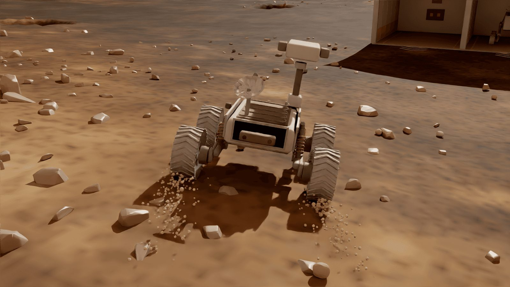

<sub>Pathfinder on the Jezero delta front. Physics in MuJoCo, rendered in NVIDIA Isaac Sim.</sub>

</div>

---

## From the demo

Stills from the 3-minute demo video. Each rover drives in Isaac Sim with its live TabPFN decision panel on the left: the arcs it weighed, the arc it chose, and its prediction against what really happened.

<table>
<tr>
<td width="33%">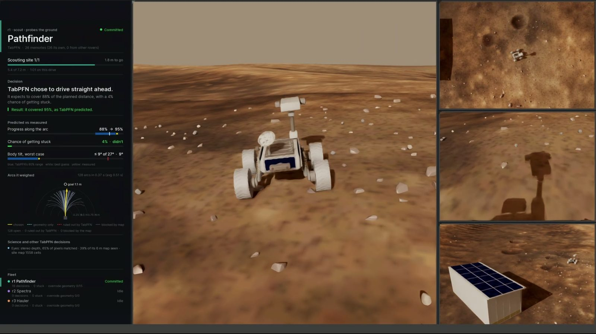</td>
<td width="33%">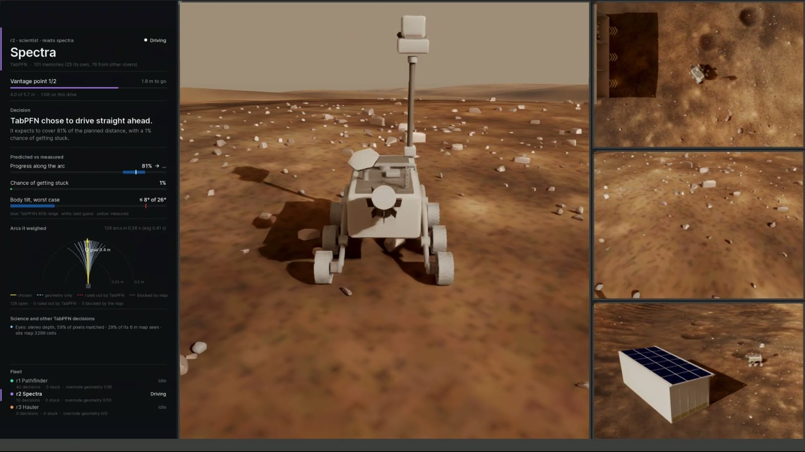</td>
<td width="33%">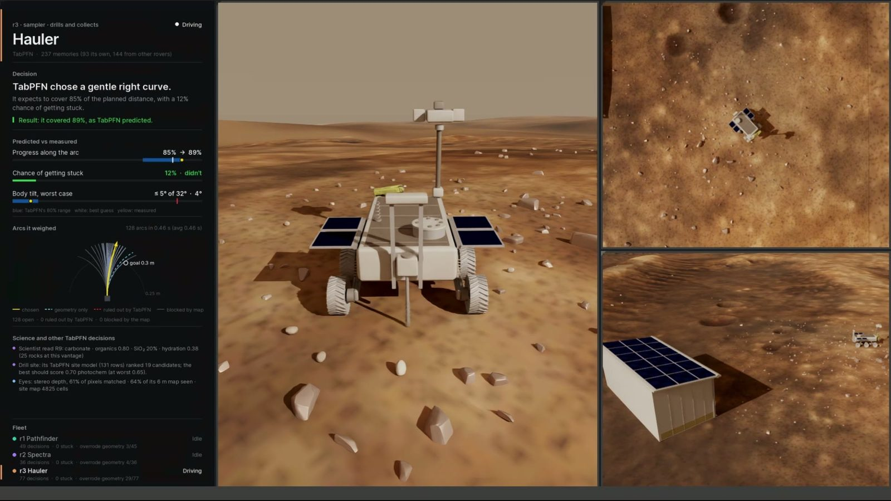</td>
</tr>
<tr>
<td><sub><b>Pathfinder</b> · scout. Probes the ground first.</sub></td>
<td><sub><b>Spectra</b> · scientist. Reads every rock in range.</sub></td>
<td><sub><b>Hauler</b> · sampler. Drills, picks the best rock, brings it home.</sub></td>
</tr>
</table>

## The idea

Mars is up to 22 minutes away by radio, so a rover cannot wait for Earth every time the ground changes under its wheels. It has to decide alone.

Rowver does not train anything. **Every metre a rover drives becomes one row** in an experience table: what it saw, what it did, its body, what happened. At every decision, **TabPFN v3.5-fast**, a tabular foundation model, reads those rows in context and predicts what each candidate action will do, with uncertainty. The rover picks the best action, tries it, and the outcome becomes the next row.

- **No gradient steps.** The weights never change; only the table does. One new row changes the next prediction.
- **No LLM in the loop.** Every action and every number comes from the table and TabPFN.
- **Different bodies, one table.** Body descriptors (mass, wheel radius, track) are columns, and a sensor a rover lacks is `NaN`. One table spans three very different machines.

Built at HackLab Robotics × BRISA, CIC Berlin (21–22 November 2026), for the Prior Labs track *"TabPFN for spatial awareness: how far can a table take a robot?"*

## The fleet

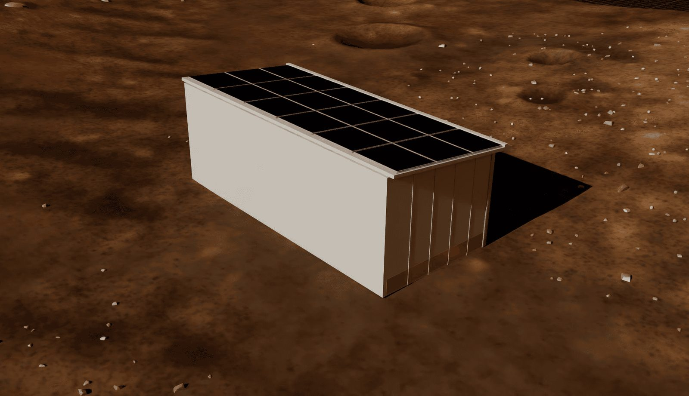

| | Pathfinder (scout) | Spectra (scientist) | Hauler (sampler) |
|---|---|---|---|
| Job | Drives to candidate sites first and probes the ground: slip, sinkage | Reads every rock in range from 0.5 to 4 m with its mast instruments | Ranks rocks, drills a core, picks the best rock with its arm and brings it home |
| Mass | 4.24 kg | 8.56 kg | 15.8 kg |
| Suspension | 4 balloon wheels on sprung swing arms | 6-wheel rocker-bogie | 6 wheels, sprung front and rear |
| Unique sensors | wheel torque, sinkage camera | RMI telescope, LIBS, Raman, VISIR | core drill, SO-101 arm, drill camera |
| Writes | `slip`, `sinkage_mm` | `photochem_score`, `mineral_class` | `drill_torque_nm`, `sample_success` |

All three have stereo navcams and hazcams. **Each rover carries its own TabPFN and its own table.** A model uses only the columns its own sensors produce, so another rover's rows help through the columns they share.

## How it decides

<table>
<tr>
<td width="32%">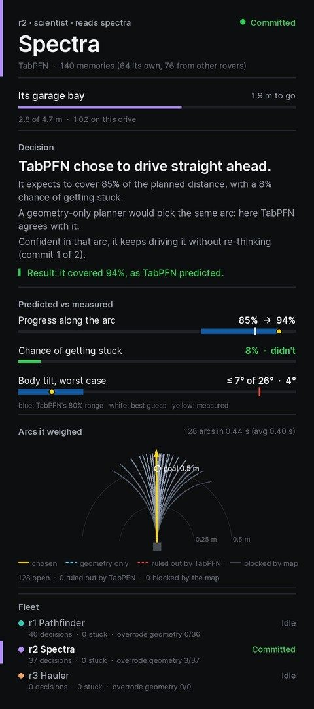</td>
<td>

About once a second, while driving:

1. **See.** The rover's own stereo cameras build a 6 m local map. No orbital maps, no hidden ground truth.
2. **Predict.** One batched TabPFN pass scores 128 candidate arcs: progress, drift and tilt as quantiles, and P(stuck).
3. **Choose.** Score the pessimistic quantiles and veto unsafe arcs. A safety shield in the body watches every 20 ms, independent of TabPFN.
4. **Try.** Drive 1 s of the chosen arc.
5. **Remember.** Add one row: what it saw, what it predicted, what really happened.

The live panel (left) writes each decision out: what TabPFN expected, what a geometry-only planner would have picked, and what happened.

</td>
</tr>
</table>

## The dock: one master table, a pack per sortie

Rovers do not stream rows to each other while they are out.

- **Upload.** When a rover parks in its bay, its new rows go into the dock's **master table**.
- **Brief.** Before each undock, the dock hands the rover a **Mission Context Pack**: at most 1,500 rows of the master table, picked for this rover and this mission (`rowver/dock.py`):

| Rule | What goes in |
|---|---|
| 1. Corridor | Rows recorded near the planned route and the target area first |
| 2. Relevance | Survey rows that measured a target this mission needs |
| 3. Body | Drive rows from bodies like this one: similar mass, wheels and track |
| 4. Rare events | Every stuck arc, failed core or deep sinkage in the corridor is kept |
| 5. Diversity | When the corridor holds more than the budget, near-duplicates are skipped |

So when Pathfinder sinks in soft sand, that probe row becomes a rare event. It rides in every pack whose route passes nearby, and Spectra and Hauler steer around sand they have never seen. The cheapest rover makes the mistake once, and the whole fleet remembers it.

**The fleet loop, phase by phase.** The master table fills as each rover docks; rows from the soft sand carry the rare-event tag.

| Phase | |
|---|---|
| **1 · Scout.** Pathfinder probes site 2 and finds soft sand: slip 0.48, sinkage 41 mm. The row becomes a rare event. | 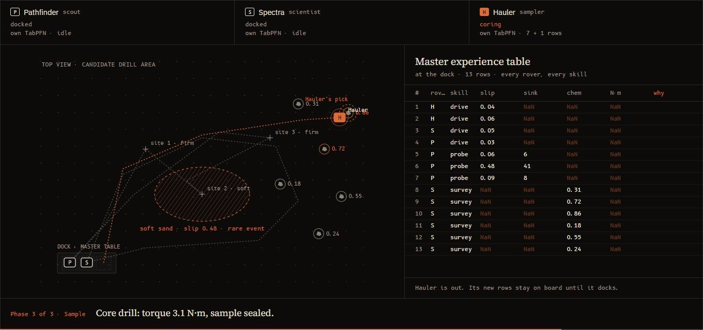 |
| **2 · Scientist.** Spectra undocks with the scout's rows, so its own TabPFN routes around sand it has never seen. | 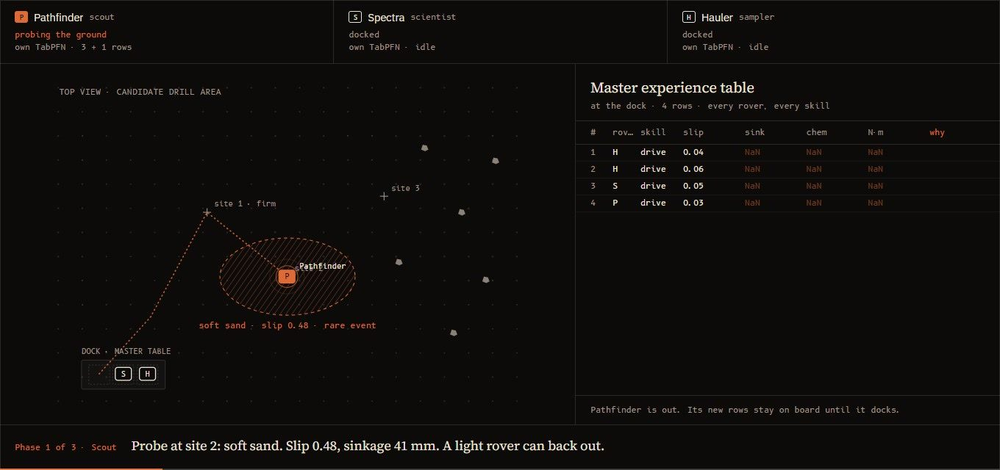 |
| **3 · Sampler.** Hauler's pack holds the rock scores, the sand and its own past drives. It drives the proven corridor and cores the best site. | 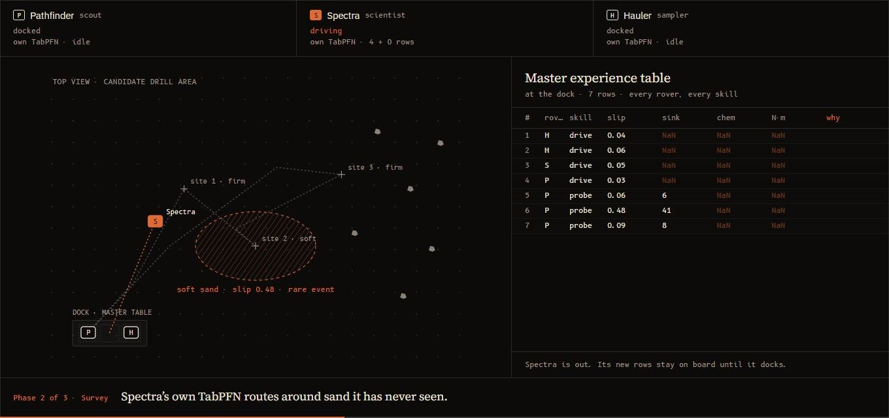 |

## Measured

First full sortie (scout, then scientist, then sampler), in simulation:

| Result | Value |
|---|---|
| Stucks across all three rovers | **0** |
| Rows in the master table after one sortie | **330** |
| True photochemistry of the drilled site (intact core in carbonate bedrock) | **0.66** |
| Rock picked, carried home and set in the tray | **1 / 1** |
| Docking error, from four headings | **5–16 mm** |
| Open-ground arcs blocked by mistake | **0 / 592** |

The headline experiment is an A/B on the same world and seed: the sampler runs once **briefed** by the dock and once with only its own rows (`--no-brief`). `rowver/tools/ab_fleet.py` runs it and `rowver/tools/ab_report.py` scores it (mean ± sd over seeds, mission rows only).

## Built on real Mars


<sub>What a rover sees: the NavCam view across the wind ripples of the delta front.</sub>

<table>
<tr>
<td width="50%"></td>
<td width="50%">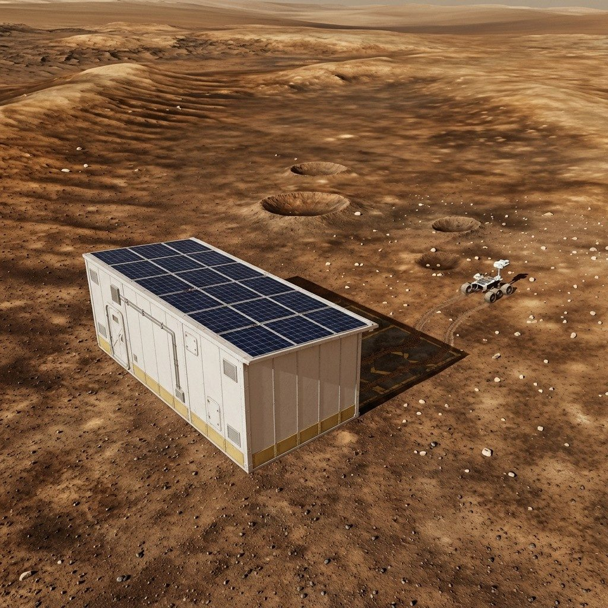</td>
</tr>
<tr>
<td><sub>Overhead camera: tracks leading out of the garage bay.</sub></td>
<td><sub>The station between the ripples. Every rover returns here to charge.</sub></td>
</tr>
</table>

| | |
|---|---|
| Terrain | HiRISE elevation model of the Jezero delta front at 1 m, orbital image at 0.25 m, sub-metre relief from photoclinometry, at 1:5 scale |
| Site | 18.53° N 77.39° E, 6.2 km from the Perseverance landing site |
| Rocks | 128 boulders found in the HiRISE image, about 12,900 more from the Golombek and Rapp size model |
| Physics | MuJoCo, with terramechanics for slip and sinkage that the brain never sees |
| Brain | TabPFN v3.5-fast, local on the GPU (an RTX 3060 answers a 1k-row predict in about 0.25 s) |
| Render | NVIDIA Isaac Sim 6.0 on an L40S: chase, overhead and NavCam views |

## Mars simulation data

The Jezero world is built from real orbital data, not drawn by hand. A separate pipeline turns HiRISE elevation models and images into a physics world for MuJoCo and a render scene for Isaac Sim, then runs and scores missions on it. The raw data (about 500 MB) lives outside this repository; the tables below describe what it holds and what it measured.

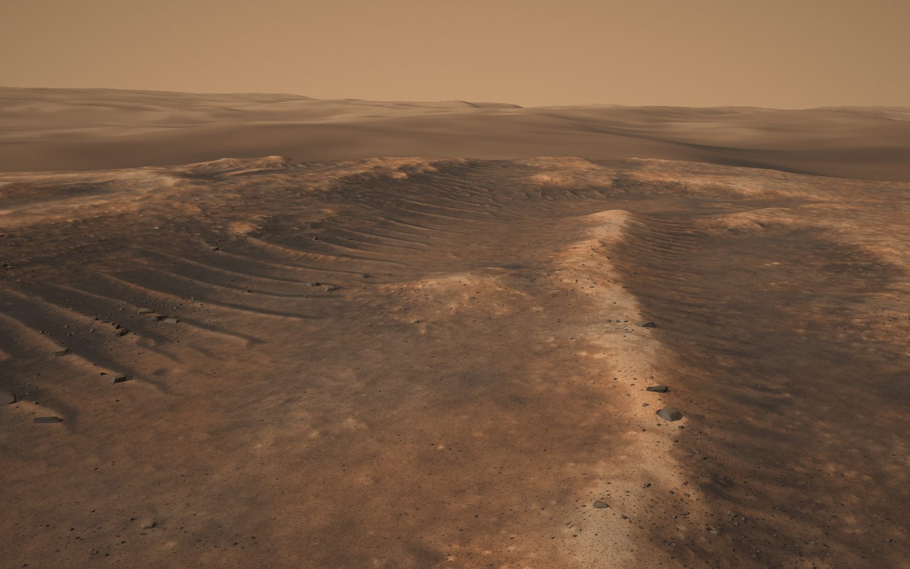

<sub>The S1 site rendered from its HiRISE elevation model: wind ripples, a bedrock ridge and soft sand between them.</sub>

### Pipeline

| Step | Script | What it does | Output |
|---|---|---|---|
| 1. Fetch | `fetch_hirise.py` | Windowed reads of HiRISE DTMs and RED orthoimages (Cloud Optimized GeoTIFFs) from the USGS Astrogeology STAC catalogue. Only the tiles that cover the window are downloaded | `data_raw/stac/`, `data_raw/scan/` |
| 2. Select | `select_site.py` | Scans every DTM at about 4 m/px with a 200 m sliding window, drops undrivable windows, ranks four terrain themes, then refines the best ones at full resolution | `sites.json`, `previews/cand_S*.png` |
| 3. Build | `build_world.py` | Builds one site deterministically from a seed: heightmap, hidden terrain classes and soft-sand patches, rocks, textures, start and goal | `world/` (the world contract, `world.json`) |
| 4. Rocks | `rocks.py` | Boulders detected in the 0.25 m image from their shadows, plus procedural rocks from the Golombek and Rapp size model, with 24 mesh variants | `world/rocks/` |
| 5. Surface | `surface.py` | Albedo, normal, roughness and displacement maps for any region at any resolution, consistent across regions | `world/terrain_*.png` |
| 6. Export | `export_mujoco.py`, `export_usd.py`, `convert_rover_glb.py` | MuJoCo height field and rock geoms at Mars gravity; the Isaac Sim 6.0 USD scene; NASA's Perseverance model converted to USD | `world/mujoco_terrain.*`, `world/scene_*.usdc` |
| 7. Verify | `verify_world.py`, `preview_local.py` | Schema, file and physics checks on the world contract (exit code 0 = all passed), and top-down and 3D previews without a GPU | `world/world_preview.png`, `previews/` |

### Candidate sites

Four 200 × 200 m candidates from two HiRISE stereo pairs (`DTEEC_045994_1985` and `DTEEC_023524_1985`). The world uses **S1**.

| Site | Theme | Centre | From the Perseverance landing site | Slope p50 / p95 | Boulders | Sand / ripples |
|---|---|---|---|---|---|---|
| **S1** | sand and outcrop | 18.5321° N, 77.3895° E | 6.2 km | 4.3° / 12.6° | 36 | 28% / 7% |
| S2 | ripples (TARs) | 18.5354° N, 77.4246° E | 5.6 km | 5.9° / 14.4° | 0 | 63% / 41% |
| S3 | crater, 112 m wide and 5 m deep | 18.3365° N, 77.5722° E | 9.4 km | 5.7° / 14.7° | 13 | 11% / 1% |
| S4 | near the landing site | 18.4285° N, 77.4501° E | 1.0 km | 5.2° / 10.3° | 2 | 39% / 27% |

<table>
<tr>
<td width="40%">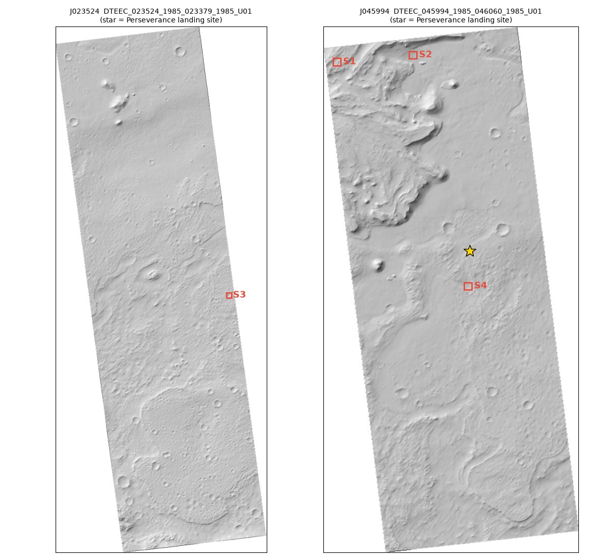</td>
<td width="60%">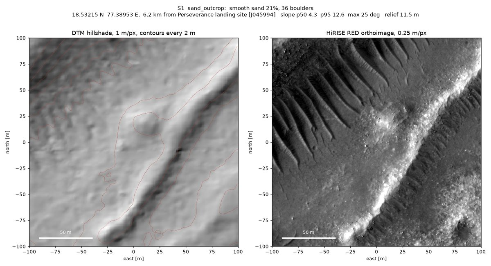</td>
</tr>
<tr>
<td><sub>The two HiRISE elevation models with the four candidates (star: the Perseverance landing site).</sub></td>
<td><sub>Site S1: hillshade at 1 m/px with 2 m contours, and the HiRISE image at 0.25 m/px.</sub></td>
</tr>
</table>

### The world contract (`world.json`, site S1, seed 7)

| Item | Value |
|---|---|
| Frame | x east, y north, z up, metres; origin at the site centre, z = 0 at the lowest point |
| Extent | 200 × 200 m, heightmap 401 × 401 at 0.5 m, relief 13.6 m |
| Rocks | 13,020: boulders detected in the HiRISE image plus the Golombek and Rapp model |
| Hidden ground truth | 40 terrain patches (soft sand, bedrock, gravel) with their slip and sinkage. Sim-only: the rover's brain never reads them |
| Textures | 4096 px over the site (4.9 cm per pixel): albedo, normal, roughness, displacement |
| Backdrop | Near ring 600 m at 1 m, far ring 10 km at 20 m, with Mars curvature (render only, not physics) |
| Sun | Azimuth 267°, elevation 30°, matching the HiRISE image so baked shading agrees |
| Route check | Straight A → B is 145 m and crosses 19 m of sand with 20 rocks within 15 m; a feasible detour is 172.5 m |
| Source | HiRISE DTM `DTEEC_045994_1985_046060_1985_U01` + orthoimage `ESP_045994_1985_RED_A_01_ORTHO`; 5,793 seam pixels repaired, 26 spikes removed |

<p align="center">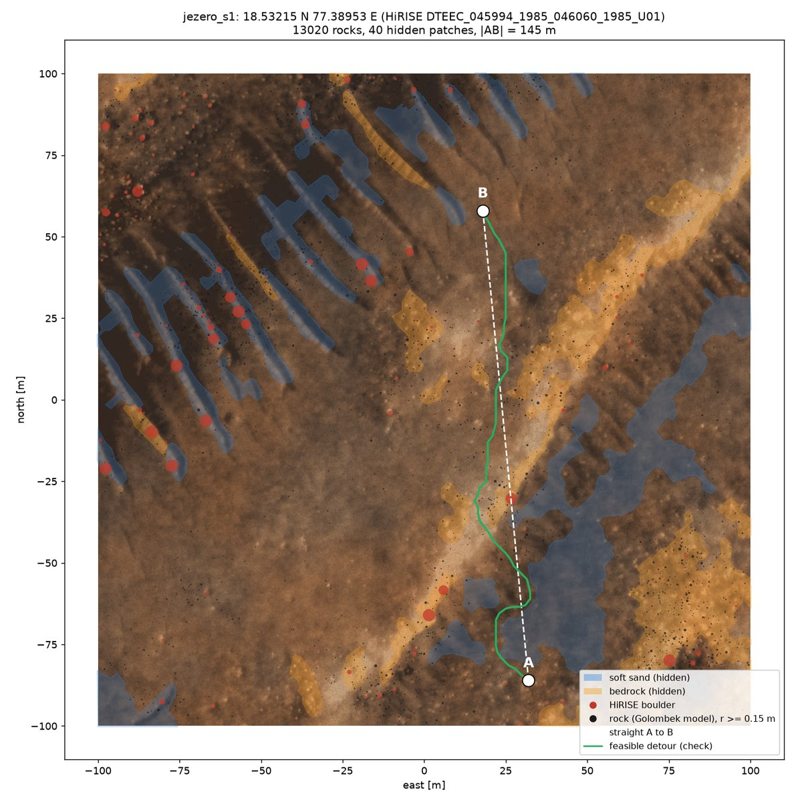</p>

<p align="center"><sub>Site S1 from above: hidden soft sand (blue) and bedrock (orange), HiRISE boulders (red), the straight line A → B and the feasible detour (green).</sub></p>

### Mission runs

Each run writes its experience table (`experience.csv`), events, legs and poses. `geometric` is the planner without TabPFN; `tabpfn` is the same rover with TabPFN predicting slip.

| Run | Brain | Legs | Sim time | Experience rows |
|---|---|---|---|---|
| `_station_test` | geometric | 12 | 3.2 h | 1,605 |
| `station_20261121_210435` | geometric | 6 | 1.6 h | 815 |
| `station_geo_cam` | geometric | 0 | 18 min | 182 |
| `nominal_viewer` | geometric | – | 25 min | 130 |
| `station_tabpfn` | tabpfn | 9 | 2.6 h | 1,250 |
| `station_run1` | tabpfn | 4 | 1.9 h | 718 |
| `station_live` | tabpfn | 0 | 21 min | 153 |
| `station_tabpfn_cam` | tabpfn | 0 | 7 min | 36 |

### TabPFN when sensors fail

`eval_dropout.py` takes a rover's own experience table and knocks out sensor readings (and turns a tenth of them into wild spikes), then asks TabPFN to predict slip on the next 120 m from a 250 m context. There is no imputation and no retraining.

| Sensor readings lost | Slip error (MAE) | Measured slip inside the 10–90% range (target 0.8) |
|---|---|---|
| 0% | 0.017 | 0.82 |
| 10% | 0.018 | 0.77 |
| 20% | 0.020 | 0.81 |
| 30% | 0.023 | 0.80 |
| 50% | 0.027 | 0.77 |
| 70% | 0.036 | 0.83 |

Even with 70% of the readings gone, the error stays about half of the no-information level (0.07, the usual slip), and the uncertainty stays honest: the range still holds about 80% of the outcomes.

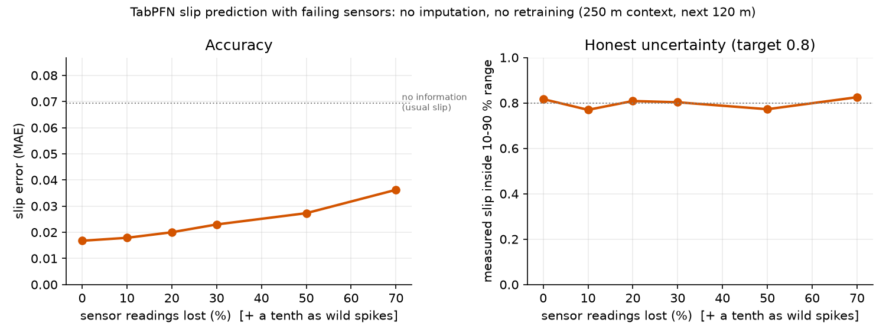

### Wheel health from telemetry

The same table catches a failing wheel. `plot_health.py` compares each wheel's measured motor current with what TabPFN expects from the baseline table. In `station_run1` the right-middle wheel's hidden wear starts, TabPFN's warning follows, and only then does the wheel seize; it is repaired in the garage.

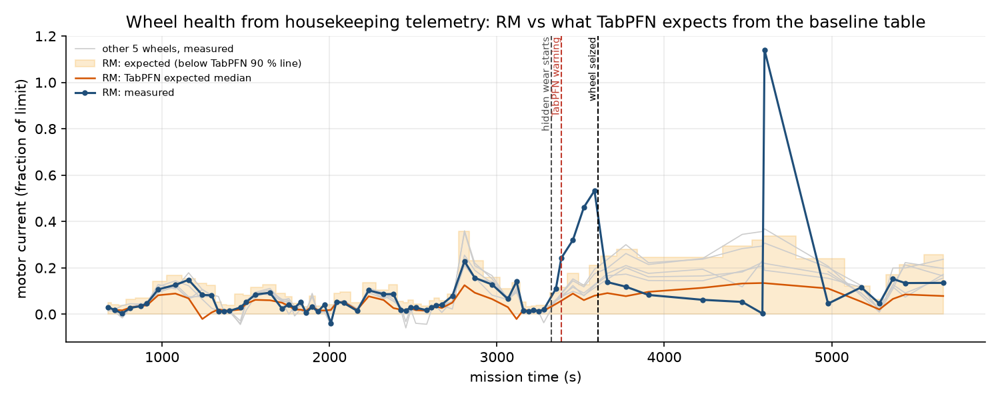

<details>
<summary><b>What's in the data folder</b> (about 500 MB, outside this repository)</summary>

| Folder | Size | Contents |
|---|---|---|
| `data_raw/stac/` | 36 KB | STAC records of the two HiRISE DTMs and the orthoimage |
| `data_raw/scan/` | 51 MB | 4 m scans of both DTMs and orthoimages, plus 19 full-resolution refinement windows |
| `data_raw/sites/` | 42 MB | Site S1 at full resolution, with a 600 m CTX context ring |
| `data_raw/rover/` | 12 MB | NASA/JPL-Caltech Perseverance 3D model (GLB) |
| `world/` | 224 MB | The S1 world contract: heightmap, hidden class and patch maps, textures, rocks, MuJoCo and USD scenes, backdrop rings, sky |
| `sim/runs/` | 162 MB | Eight mission runs (experience tables, events, legs, poses, health and slip checks) and the dropout results |
| `previews/` | 14 MB | Candidate site sheets, renders and the evaluation charts |
| `scripts/`, `sim/`, `isaac/` | < 1 MB | The pipeline above, the rover simulation (terramechanics, sensors, autonomy, station, predictors, evaluations) and Isaac checks |

</details>

## Run it

```
.venv\Scripts\python.exe -m brain.check_tabpfn          # once: download the TabPFN v3.5-fast weights, smoke check
.venv\Scripts\python.exe -m rowver.run_fleet --gui --fresh --scout 1 --vantage 1 --sites 1 --run-name demo
```

- Leave out `--gui` to run headless.
- `--no-brief` runs the A/B control: the sampler gets no briefing from the dock.
- With `--gui`, the viewer shows the TabPFN decision panel. Keys: `9` hides or shows it, `7` switches rover, `8` turns camera follow on or off.
- Settings: `rowver/rowver.toml` (the fleet) and `brain.toml` (the brain). Copy `.env.example` to `.env` for the TabPFN device and backend.

<details>
<summary><b>Isaac Sim view</b> (Linux GPU box, e.g. Brev L40S with the Isaac Launchable)</summary>

MuJoCo keeps all the logic (physics, TabPFN, decisions). Isaac Sim 6.0.1 only mirrors and renders it: live over
a local socket, or offline from a recording. Nothing in `rowver/tools/isaac_*.py` simulates anything.

Setup on the box (once):
```
cd ~/rowver && python3 -m venv .venv
.venv/bin/pip install torch torchvision --index-url https://download.pytorch.org/whl/cu126
.venv/bin/pip install -r requirements.txt usd-core timm         # usd-core: the recorder; timm: the navcam's DINOv2
.venv/bin/python -m brain.check_tabpfn                          # TabPFN v3.5-fast on the GPU
docker cp rowver/tools/. vscode:/tmp/rowver_tools/              # the Isaac scripts, into the Isaac container
# + /tmp/rowver_tools/mars_sky.hdr, backdrop/ (HiRISE + CTX rings), navcams.json, dust_wheels.json
```

Live (watch at `https://<the instance's port-80 secure link>/viewer`):
```
./run_mission.sh live --scout 1 --vantage 2 --sites 1 --sampler-sorties 2 --seed 0 --live --record
./restart_mirror.sh                      # Isaac mirror: chase view + top + overview, TabPFN panel on the left
```
- `run_fleet.py --live` (`rowver/live.py`) writes the static scene once (`scene.usdc`, `terrain.usdc`), copies it into
  the container and streams the poses that moved (UDP, 30 Hz of sim time) and the panel image (TCP). It paces the
  sim to real time (`--live-realtime`); the brain counts sim seconds, so decisions do not change.
- `restart_mirror.sh` flags: `--views top,navcam,overview`, `--haze 0.3`, `--film-iso 70`, `--motes`, `--no-fx`,
  `--chrome` (keep the editor UI). The mission keeps running while the mirror restarts.

Fallback video from a recording (`--record`, `rowver/record.py`: animated USD + poses + panel images):
```
docker cp runs/<run>/record vscode:/tmp/rowver_rec
docker exec -u ubuntu:ubuntu -w /isaac-sim vscode /isaac-sim/python.sh /tmp/rowver_tools/isaac_render.py \
    --dir /tmp/rowver_rec --out /tmp/rowver_render --step 2          # --count 10 for a look first
docker cp vscode:/tmp/rowver_render ~/render
ffmpeg -framerate 15 -pattern_type glob -i "$HOME/render/frame_*.png" -c:v libx264 -pix_fmt yuv420p -crf 18 demo.mp4
.venv/bin/python -m rowver.tools.compose_panel --frames ~/render --record runs/<run>/record --out ~/render_panel
ffmpeg -framerate 15 -pattern_type glob -i "$HOME/render_panel/frame_*.png" -c:v libx264 -pix_fmt yuv420p -crf 18 demo_panel.mp4
```

</details>

## Repository layout

| Path | What it is |
|---|---|
| `rowver/` | The fleet: the world (`world.py`, `jezero.py`, `terrain.py`), the rovers (`mars_rover.py`, `rover*.py`, `navcam.py`, `stereo.py`), the garage and dock (`dock.py`), the missions, and the TabPFN decision panel (`panel.py`, `panel_card.py`). Entry point: `run_fleet.py` |
| `rowver/rowver.toml` | The fleet's settings: drive, safety, memory, refits. Every value is tagged with its source |
| `rowver/assets/jezero/` | The Jezero site the simulation loads (heightmap, albedo, rocks, physics) |
| `rowver/tools/` | `import_jezero.py` and `fit_navcam_pca.py` rebuild the assets; `ab_fleet.py` and `ab_report.py` run and score the briefing A/B; `isaac_*.py` mirror and render in Isaac Sim |
| `brain/` | Cortex, the robot-agnostic brain: hippocampus (memory), cerebellum (TabPFN), prefrontal (the planner), and the TabPFN loader. See [`brain/README.md`](brain/README.md) |
| `brain.toml` | The brain's settings |
| `so101/` | The SO-101 arm on Hauler: its code, its MuJoCo model, and the lab's pick rows that seed it |
| `docs/` | The write-up ([`idea.md`](docs/idea.md)), the slides (`Rowver.pptx`, `Rowver.pdf`) and the images in this README |
| `runs/` | Created by each run: the experience tables and logs (git-ignored) |
| `.env` | TabPFN device, backend and estimator count. Keep it out of any commit (`.env.example` shows the keys) |

`rowver` and `so101` import `brain`. `brain` imports no robot.

## Why a fleet

One rover is a single point of failure and a physics trade-off: a heavy arm rover sinks in the same soft sand a light scout crosses safely. That is why NASA (CADRE) and DLR and ESA (ARCHES) are moving to teams of different robots. The catch is that standard learned models break when robots carry different sensors. TabPFN handles missing columns natively and needs no retraining, so the docking table turns separate, specialised rovers into one shared spatial brain.

<p align="center">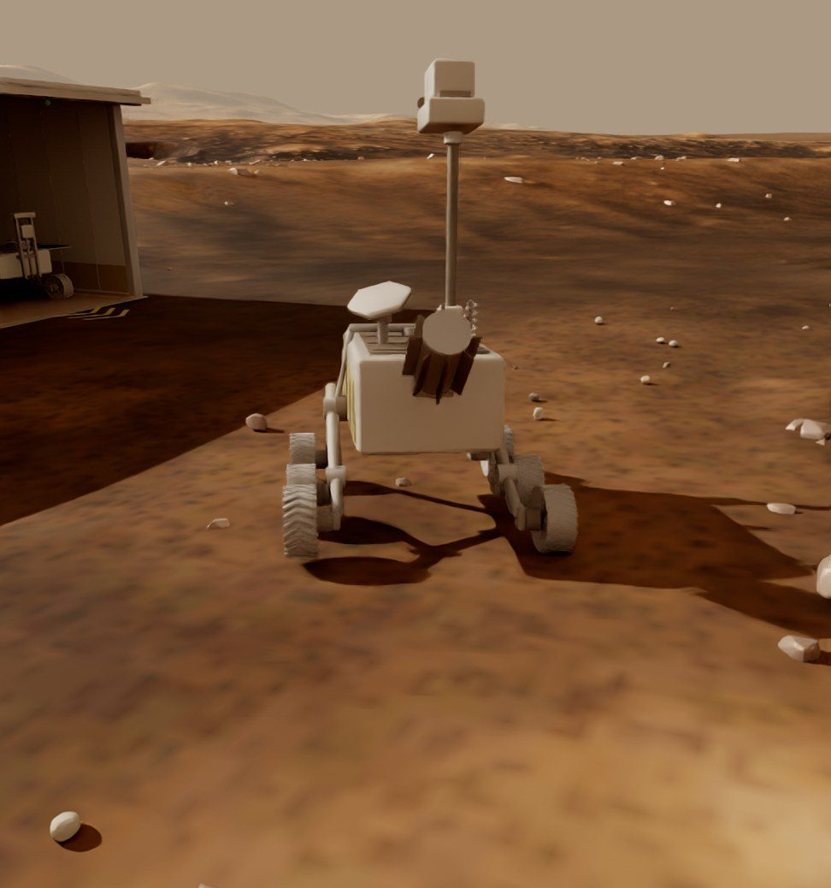</p>

<p align="center"><i>They don't call home. They add a row.</i></p>

## Licence

The TabPFN v3.5 weights are non-commercial (CC BY-NC).
